# Use cases

What data_organizer is for, shown on one example from start to finish.

> All screenshots use made-up data: three invented drives of an invented user
> "Anna", filled with random bytes under realistic names. No real files were
> used.

## The situation

Anna has three old storage devices and no idea what is on which:

| Drive | What it is | What's on it |
|---|---|---|
| `D:` | the disk from her old laptop | her user folder: documents, photos, music, videos, plus Windows, caches and downloads |
| `E:` | an external drive where everything ended up | a full copy of the laptop's user folder ("Laptop backup 2016"), a second partial copy, photos, a phone import made twice, videos, music |
| `F:` | a USB stick | a thesis backup, photos to print, a tax return, a contract |

Together that is **2.5 GB in 927 files**. She wants one clean archive on her
new disk (`G:`), with each photo and document once, before she wipes the old
devices.

The result, at the end of this page: **1.1 GB in 351 files**, nothing lost.

## 1. Back up all old disks in one go

Under **New backup**, select the drives (click, then Ctrl+click; or Space on
the keyboard) and press **Start backup**. Several drives go into one backup,
so duplicates are found *across* drives, not only within one.

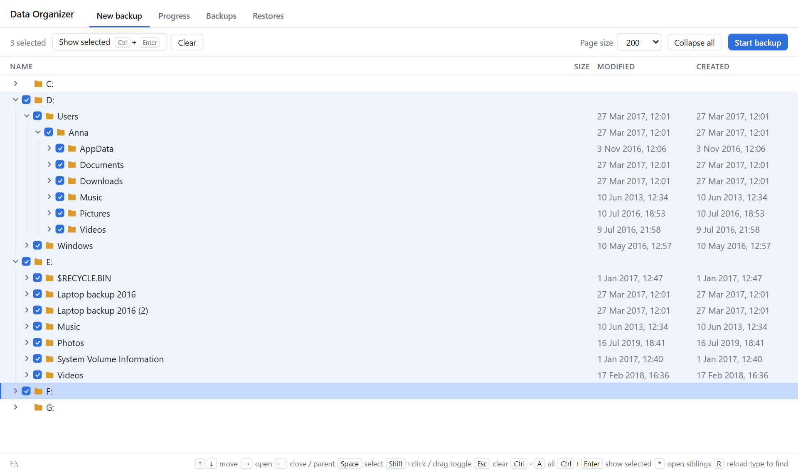

The backup first counts everything, then reads each file once, hashes it and
stores its content compressed. One bar, the speed and the time left:

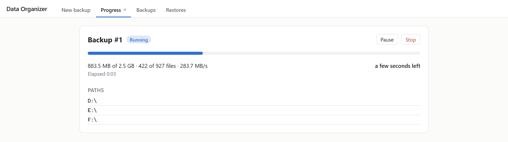

### Big drives over several evenings

A real old drive takes longer than this example. **Pause** whenever you need
the disk or the computer, and **Resume** later. Closing the program (or a
crash) keeps the backup too: it continues by itself on the next start, and at
most the last second of work is done again.

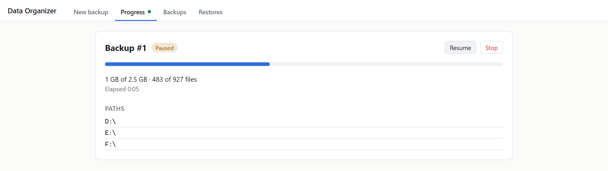

Each distinct content is stored once: the 2.5 GB of this example took
1.2 GB in the content store. From here on, the old devices are not needed any
more. Restoring reads only the store.

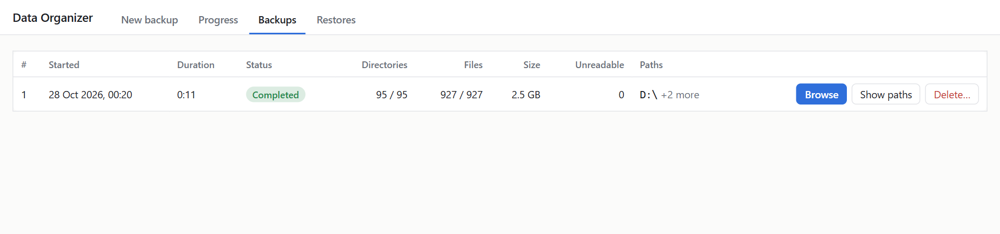

## 2. See what exists twice

**Browse** the backup. Every file *and every folder* has a content hash, so
whole folders are recognized as copies, whatever they are called and wherever
they are. A later copy is struck through: an earlier one exists, and only the
earliest is restored.

Here, on `E:`, the whole `Laptop backup 2016` folder is struck through: it is
an exact copy of `D:\Users\Anna`. So are `Music` and the `2014 Barcelona`
album. `2017 Iceland` and `Phone import 2019` exist only here.

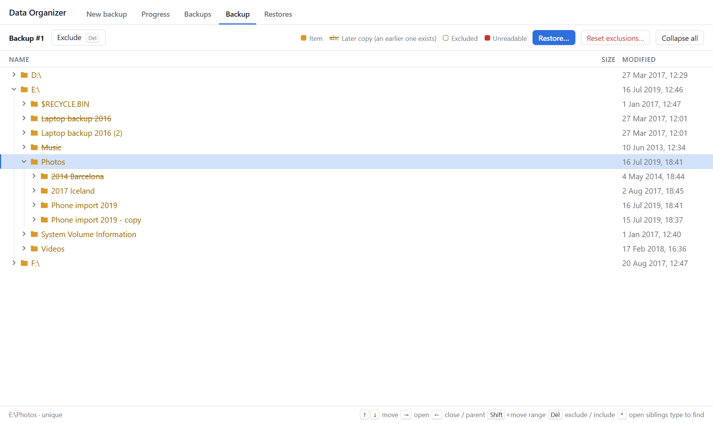

Renamed copies are found too: the phone photos were imported twice, the
second time as `… (1).jpg`. The status bar says how many copies there are.

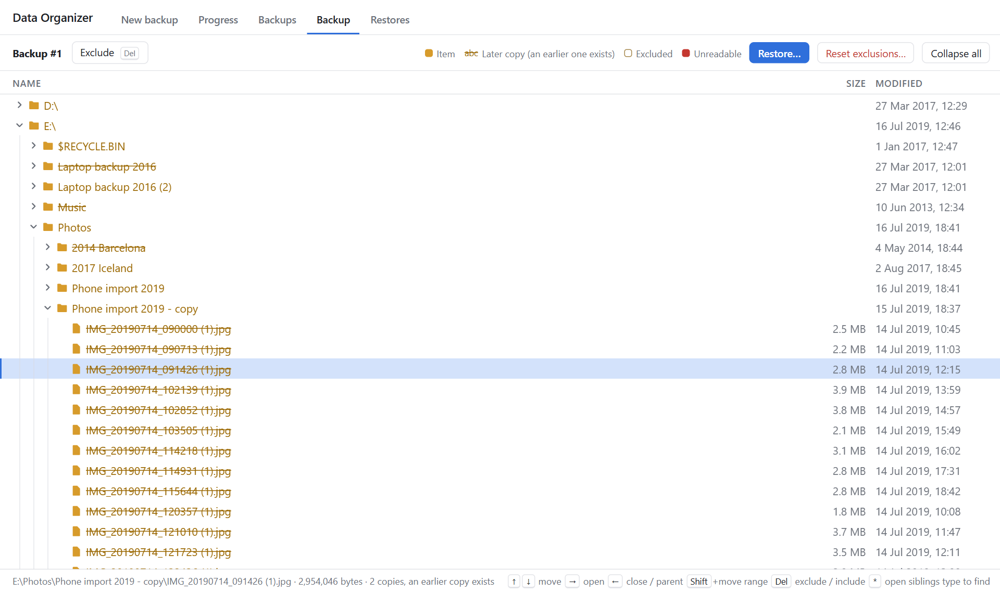

## 3. Leave out what you don't want

Select an item and press **Delete** (or **Exclude**) to leave it and
everything below it out of the restore. Anna leaves out the laptop's
`Windows`, `AppData` (caches, temp files) and old installers in `Downloads`,
and on `E:` the recycle bin and `System Volume Information`. Excluded items
show an outlined folder and are struck through.

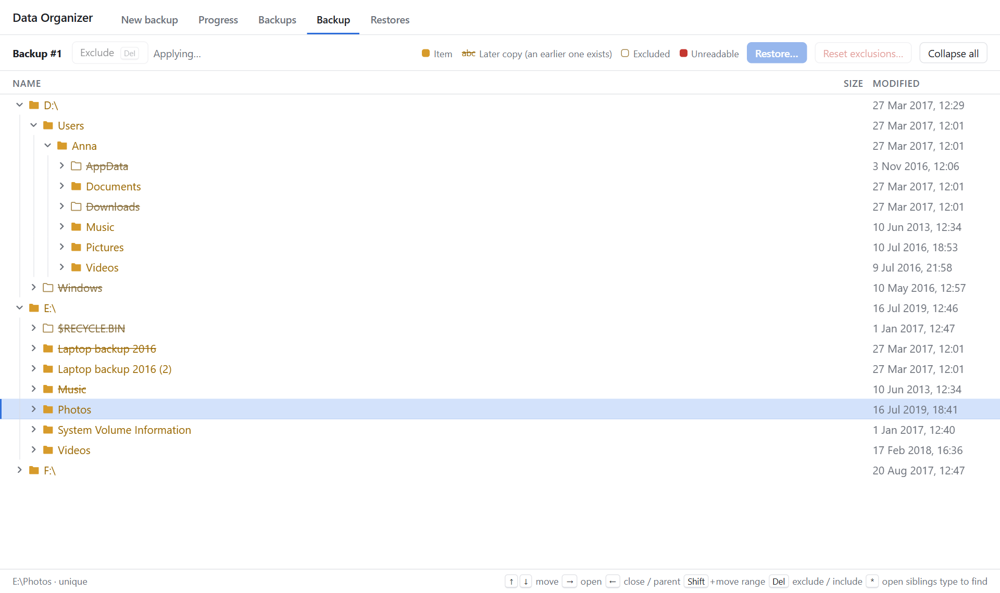

**Watch the copies of what you exclude.** Excluding the first copy makes the
next copy the one that is restored. `E:\Laptop backup 2016\Anna\AppData` is
no longer struck through: it is now the first copy that is not excluded.

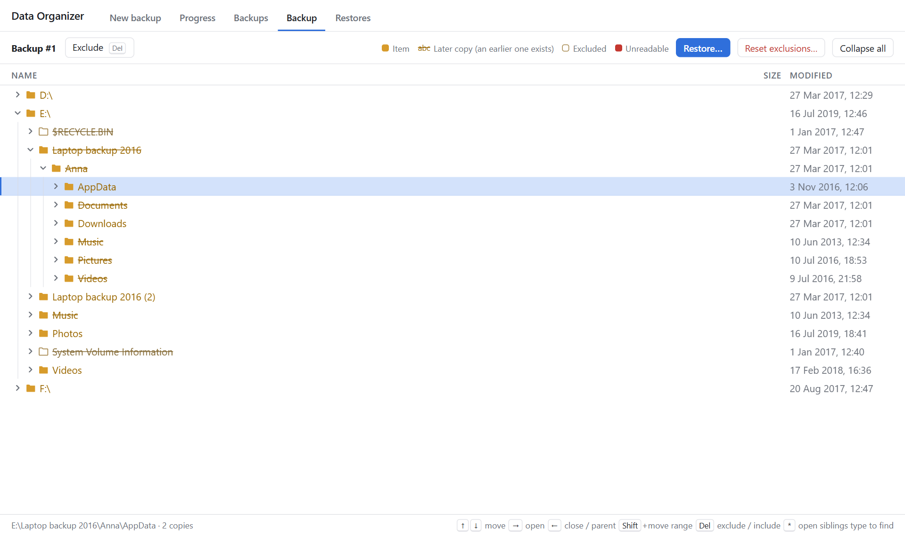

So exclude it there too:

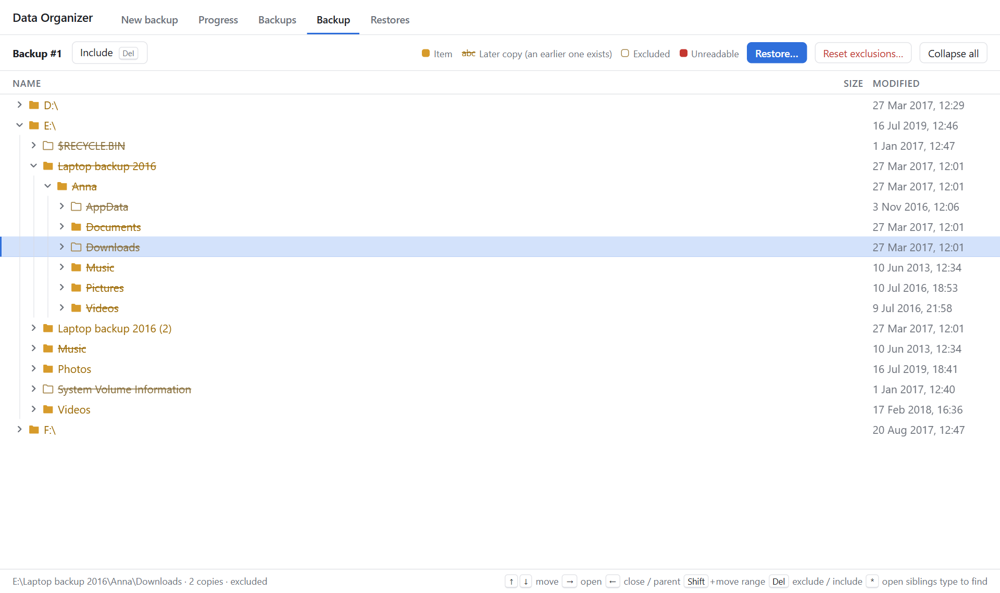

Exclusions are saved as you go. **Reset exclusions…** starts over.

## 4. Restore one clean copy

Press **Restore…** and choose a new or empty folder. Each backed-up drive
keeps its structure below it: `D:\Users\Anna` becomes
`G:\Archive\D\Users\Anna`.

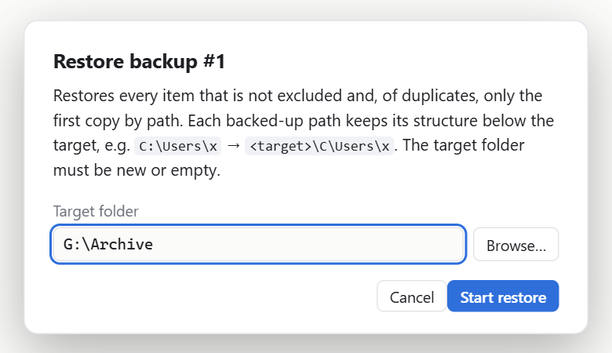

The restore writes every kept item once, from the content store, checking
each file's hash. Like a backup, it can be paused and survives a restart.

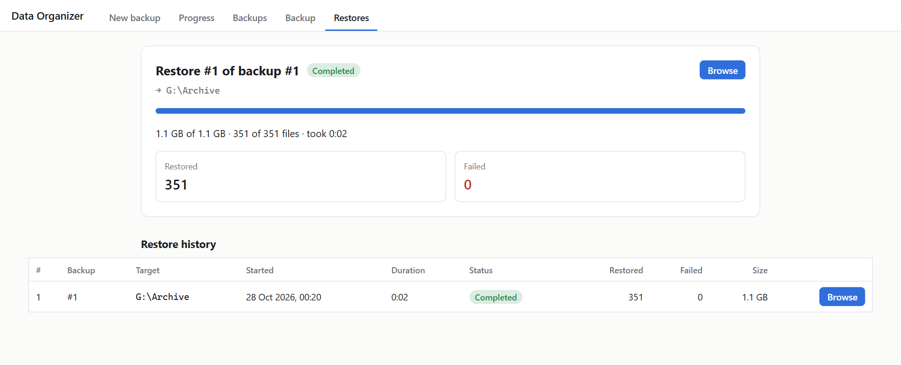

**Browse** the restore to see what was written where, and what failed. Folders that only held copies are kept as empty folders (here
`Laptop backup 2016 (2)` and `Phone import 2019 - copy`), so the structure
stays recognizable.

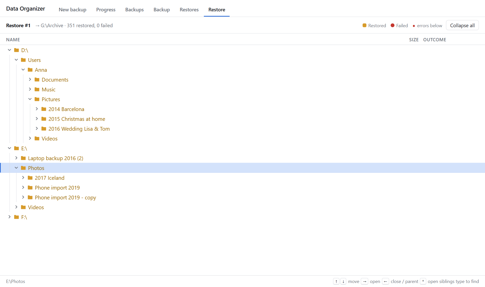

## 5. Retire the old devices

Check the archive (open a few photos and documents) before you wipe or give
away the old devices. data_organizer never changes or deletes the backed-up
files; deleting a backup removes only its stored data.

## More situations it fits

- **"Which of these backups is the latest?"** Back up all candidates together
  and browse: identical folders are struck through, so the folders that
  differ stand out.
- **A family's photo collection spread over several computers and phones.**
  Connect or copy them to one computer, back them all up in one backup (the
  duplicate search works within a backup), then restore every photo once.
- **Before reinstalling or selling a computer.** Back up the whole drive to an
  external disk, leave out system folders, and restore only your own data on
  the new machine.

Also see the [README](../README.md) (install, options, where data goes) and
[architecture.md](architecture.md) (how it works inside).
